# Laravel Multi-Page Web App

A multi-page Laravel web application built as a group activity. Each member built one module (page) using HTML, CSS, and JavaScript inside Blade templates. All pages share one layout and navigation.

## Group Information

- **Group name:** PowerPuff Girls
- **Section:** GWLM1
- **Repository name:** `Lara-Proj-GWLM1-Ayuban-Bojawe-Buba`

### Members

| Member | Name | Role |
|---|---|---|
| Member 1 | Ayuban, Charriel Mae | Group Leader |
| Member 2 | Bojawe, Hazel Mae P. | Member |
| Member 3 | Buba, Ashley Queen   | Member |

## Theme

Band Site

## Modules and Branches

| Member | Role | Module | Branch | Route |
|---|---|---|---|---|
| Ayuban | Group Leader | Project setup, master layout, Home page | `dev-member1-Ayuban` | `/` |
| Bojawe | Member | About page | `dev-member2-Bojawe` | `/about` |
| Buba | Member | Contact page | `dev-member3-Buba` | `/contact` |

### Files per module

| Module | Blade view | CSS | JavaScript |
|---|---|---|---|
| Layout | `resources/views/layouts/app.blade.php` | `public/css/app.css` | none |
| Home | `resources/views/home.blade.php` | `public/css/home.css` | `public/js/home.js` |
| About | `resources/views/about.blade.php` | `public/css/about.css` | `public/js/about.js` |
| Contact | `resources/views/contact.blade.php` | `public/css/contact.css` | `public/js/contact.js` |

### JavaScript features

| Page | Feature |
|---|---|
| Home | Image slider or dark/light mode toggle |
| About | Read More / Read Less toggle or animated number counters |
| Contact | Client-side form validation with error messages and a success message |

## Screenshots

### Home

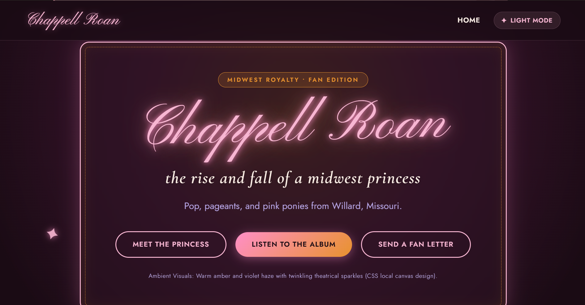

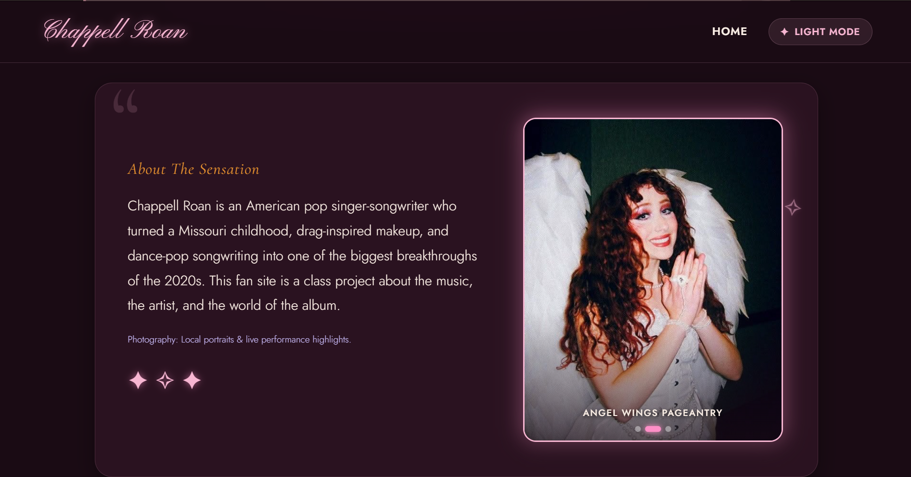

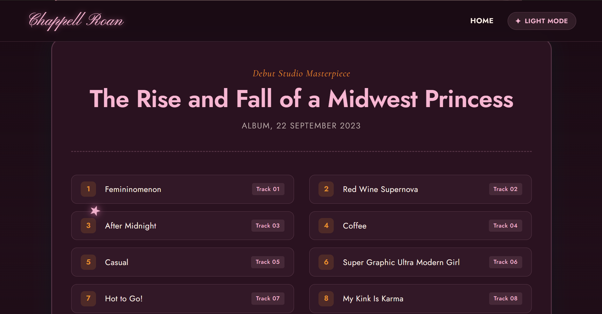

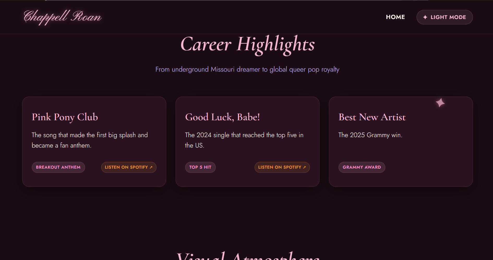

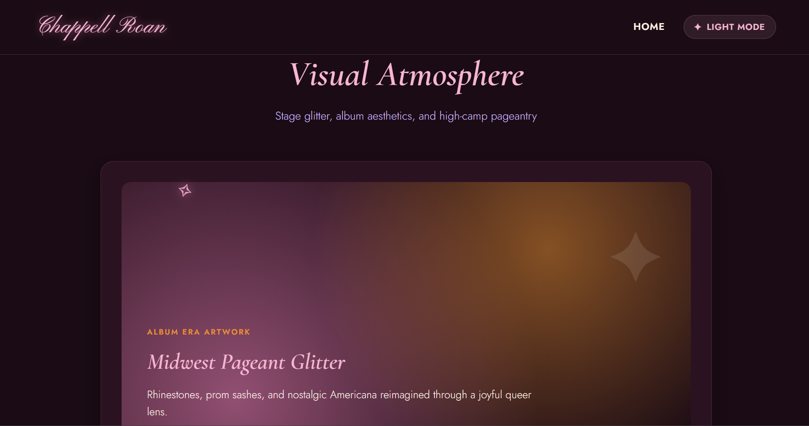

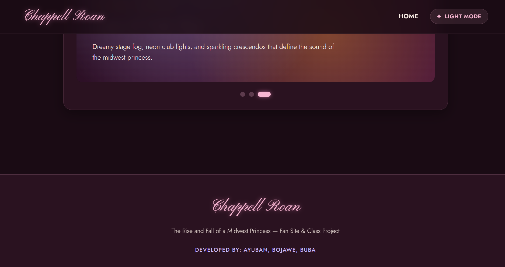

### About

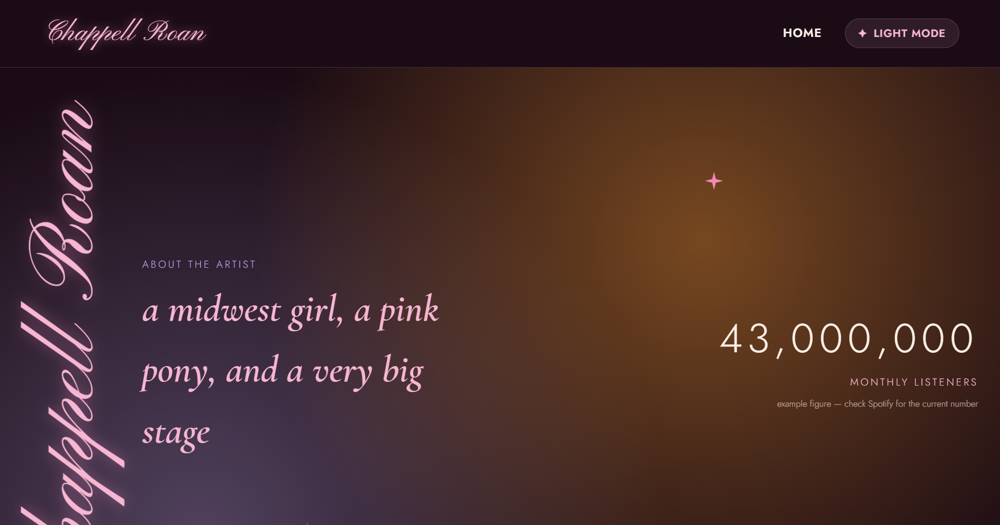

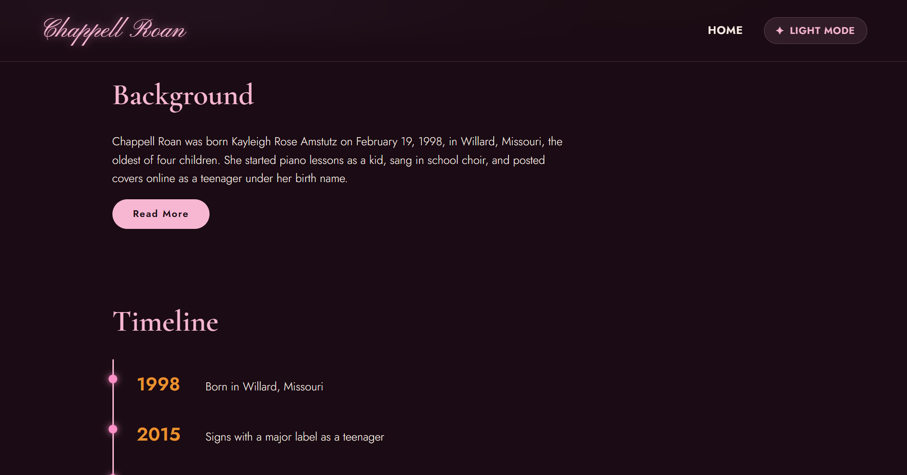

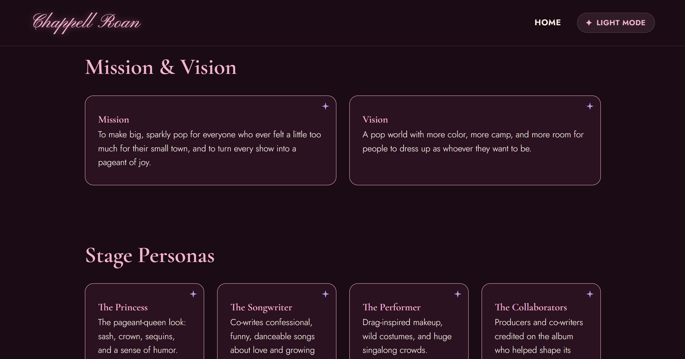

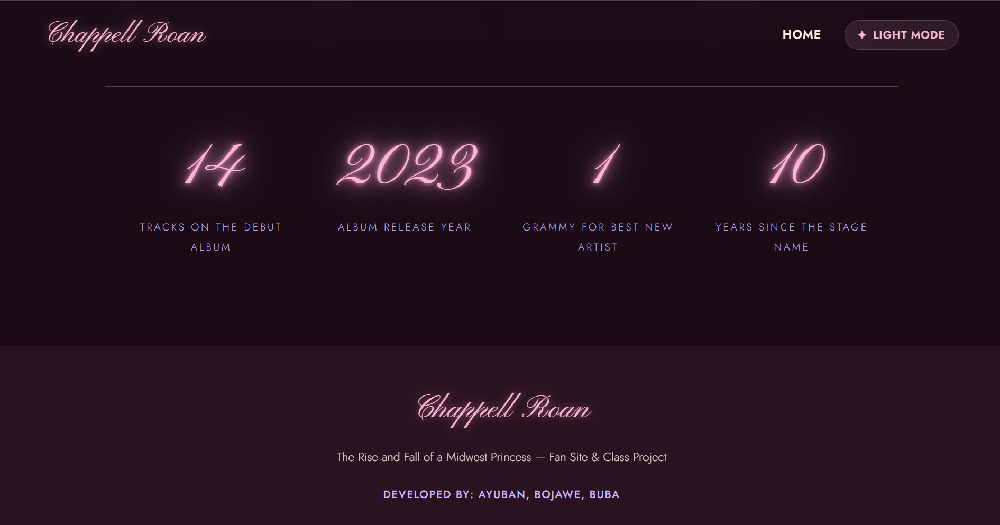

### Contact

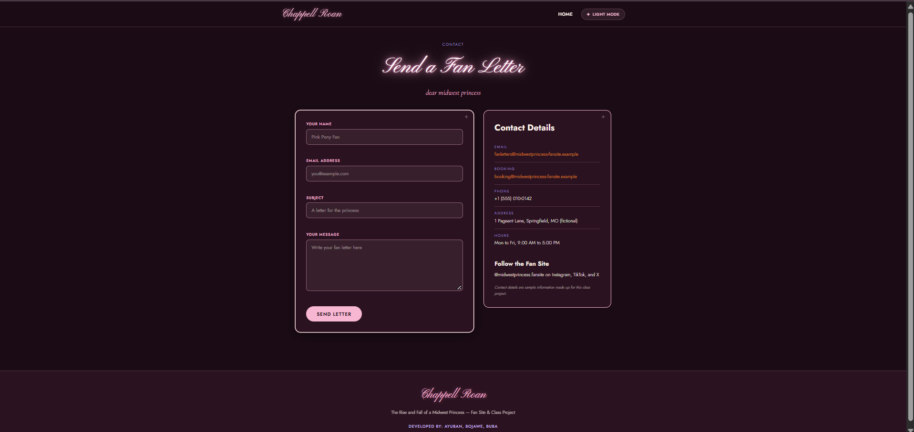

## Steps to Run the Project

### Requirements

- PHP 8.2 or higher
- Composer
- Git

### Installation

1. Clone the repository:

   ```bash
   git clone https://github.com/charrielmae/Lara-Proj-GWLM1-Ayuban-Bojawe-Buba.git
   ```

2. Go into the project folder:

   ```bash
   cd <Lara-Proj-GWLM1-Ayuban-Bojawe-Buba>
   ```

3. Install the dependencies:

   ```bash
   composer install
   ```

4. Create the environment file:

   ```bash
   cp .env.example .env
   ```

   On Windows Command Prompt, use `copy .env.example .env` instead.

5. Generate the application key:

   ```bash
   php artisan key:generate
   ```

6. Run the migrations (answer `yes` if asked to create the database):

   ```bash
   php artisan migrate
   ```

7. Start the development server:

   ```bash
   php artisan serve
   ```

8. Open the app in your browser at `http://127.0.0.1:8000`.

### Pages

| Page | URL |
|---|---|
| Home | `http://127.0.0.1:8000/` |
| About | `http://127.0.0.1:8000/about` |
| Contact | `http://127.0.0.1:8000/contact` |

## Git Workflow

- Each member worked only in their own branch (e.g `dev-member#-Ayuban`).
- No one pushed directly to `main`. Work was merged through Pull Requests.
- The Group Leader reviewed and merged all Pull Requests.
- The `.env` file and the `vendor` folder are not committed.